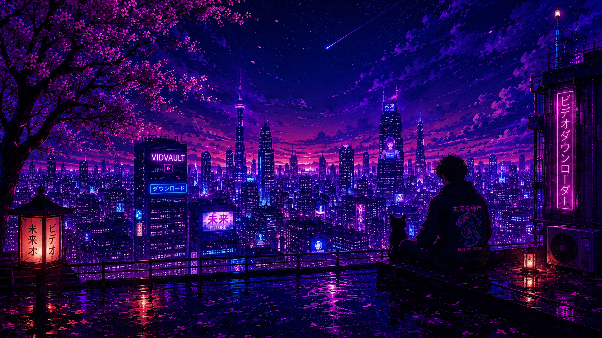

# ⚡ VidVault

<p align="center">
  
</p>

<p align="center">
  <strong>Next-Gen High-Performance YouTube Video & Audio Downloader</strong><br>
  Built with a zero-build lightweight frontend and a resilient Python Flask backend powered by <code>yt-dlp</code> and <code>FFmpeg</code>.
</p>

<p align="center">
  
  
  
  
  
  
  
</p>

---

## 🌟 Key Highlights

- 🚀 **Zero-Build Architecture:** No `node_modules`, no TypeScript compilation, and no heavy bundlers. Native ES6+ JavaScript, Tailwind CSS, and HTML5 load instantaneously in any browser.
- 🎥 **Full HD & 4K Video Streams:** Download videos in **4K (2160p)**, **2K (1440p)**, **1080p**, **720p**, **480p**, and **360p** in standard MP4 containers.
- 🎵 **Crystal-Clear Audio Extraction:** Extract audio directly in high-bitrate **MP3 (320kbps, 192kbps, 128kbps)** or native lossless M4A.
- 🖼️ **Thumbnail Downloader:** Save original YouTube thumbnails in **Ultra HD (1080p MaxRes)**, **Standard (720p)**, and **HQ (480p)** JPG with automatic resolution fallback.
- ⚡ **Streamlined Muxing:** High-speed FFmpeg stream joining combining video and audio streams seamlessly without CPU burn.
- 📊 **Live Download Progress Polling:** Real-time progress updates including percentage, current transfer speed (MB/s), stage descriptions, and estimated time remaining (ETA).
- 🌌 **Interactive Cyberpunk Ambient Engine:** Built-in HTML5 Canvas engine featuring drifting sakura petals, floating cyber embers, shooting stars, and smooth parallax scrolling.
- 🤖 **AI Content Insights:** Instant SEO metadata analysis generating high-CTR titles, viral potential meters, suggested keywords, and content summaries.
- 🛡️ **Resilient YouTube Auth & Fallbacks:** 
  - Compatible with Render Secret Files (`/etc/secrets/cookies.txt`) with safe read-only memory mirroring.
  - Automatic fallback to anonymous download if expired session cookies trigger `HTTP Error 403: Forbidden`.
  - Node.js 22 LTS integrated for YouTube JavaScript challenge solving.

---

## 🏗️ Architecture & Tech Stack

```text
┌─────────────────────────────────────────────────────────────┐
│                      CLIENT / FRONTEND                      │
│   Vanilla JS (ES6+) • Tailwind CSS (CDN) • Lucide Icons      │
│   Canvas 2D Ambient Engine • Responsive Glassmorphism UI    │
└──────────────────────────────┬──────────────────────────────┘
                               │  REST API (JSON / Fetch)
                               ▼
┌─────────────────────────────────────────────────────────────┐
│                      BACKEND (Flask)                        │
│   Python Flask • Multi-threaded Worker Pool • Semaphore      │
│   Auto-retry Logic • Cookie Session Cache Engine             │
└──────────────────────────────┬──────────────────────────────┘
                               │
               ┌───────────────┴───────────────┐
               ▼                               ▼
     ┌──────────────────┐            ┌──────────────────┐
     │      yt-dlp      │            │      FFmpeg      │
     │ Stream Extractor │            │ Container Muxer  │
     └──────────────────┘            └──────────────────┘
```

---

## 📁 Project Structure

```text
vidvault/
├── index.html              # Main frontend interface & layout
├── css/
│   └── style.css           # Glassmorphism, animations & background styles
├── js/
│   ├── app.js              # Application logic, format mappings, progress polling
│   └── canvas.js           # Ambient cyberpunk background engine & parallax scroll
├── cyberpunk_full_bg.png   # Full-width background graphic
├── backend/
│   ├── app.py              # Flask server, API endpoints, download orchestrator
│   ├── requirements.txt    # Python dependencies (Flask, yt-dlp, gunicorn, etc.)
│   ├── render-build.sh     # Render build script (installs static FFmpeg & Node 22)
│   ├── cookies.txt         # (Optional) YouTube cookies file (git-ignored)
│   └── downloads/          # (Optional) Local download storage directory
├── Dockerfile              # Production container config with Node 22 LTS & FFmpeg
├── vercel.json             # Static hosting configuration for Vercel
├── DEPLOYMENT.md           # Production deployment guide
└── README.md               # Project documentation
```

---

## ⚡ Quick Start (Local Development)

### 1. Prerequisites
- **Python 3.10+** installed ([python.org](https://www.python.org/))
- **FFmpeg** installed and added to your system `PATH`:
  - *Windows (via winget):*
    ```powershell
    winget install Gyan.FFmpeg
    ```
  - *macOS (via Homebrew):*
    ```bash
    brew install ffmpeg
    ```
  - *Linux (Debian/Ubuntu):*
    ```bash
    sudo apt update && sudo apt install ffmpeg -y
    ```

### 2. Install Dependencies
Open your terminal inside the project directory:
```bash
pip install -r backend/requirements.txt
```

### 3. Start the Server
```bash
python backend/app.py
```

### 4. Open in Browser
Visit **[http://127.0.0.1:5000](http://127.0.0.1:5000)** in your browser. 
*(No Node.js, `npm install`, or build step required!)*

---

## 🍪 Cookie Configuration (Optional)

For private videos or when YouTube displays automated verification challenges:

1. Install a browser extension such as **[Get cookies.txt LOCALLY](https://chromewebstore.google.com/detail/get-cookiestxt-locally/cclelndahbckbenkjhflpdbgdldlbecc)** (Chrome, Edge, Brave, or Firefox).
2. Visit [YouTube](https://www.youtube.com), ensure you are signed in, and export your cookies as `cookies.txt`.
3. Place `cookies.txt` into the `backend/` folder:
   ```text
   backend/cookies.txt
   ```
4. **On Render Cloud Deployments:** Add the cookie file as a **Secret File** mounted at `/etc/secrets/cookies.txt`. VidVault automatically detects and safely mirrors read-only secret files into a writable temporary directory to prevent file lock crashes.

---

## 🌐 API Reference

| Endpoint | Method | Description |
| :--- | :--- | :--- |
| `GET /` | `GET` | Serves the single-page VidVault application |
| `GET /health` | `GET` | Health check endpoint reporting FFmpeg, Node.js, and cookie status |
| `POST /api/video-info` | `POST` | Fetches metadata, thumbnail, duration, and available quality streams |
| `POST /api/download` | `POST` | Initiates video/audio download and returns download task details |
| `GET /api/download/status/<id>` | `GET` | Returns live progress percentage, stage, ETA, and speed |
| `GET /api/download/file/<id>` | `GET` | Streams the finalized media file to the client |
| `GET /api/download-thumbnail` | `GET` | Downloads video thumbnail in selected quality (maxres, sd, hq) |
| `POST /api/seo-insights` | `POST` | Generates AI content scores, optimized titles, and viral tags |

---

## 🚀 Production Deployment

### Option A: Render (Full-Stack Backend + Frontend in One Container)
1. Push your repository to GitHub.
2. In [Render Dashboard](https://dashboard.render.com/), create a new **Web Service**.
3. Select your repository and choose **Docker** runtime.
4. Render will automatically build the `Dockerfile` with Node.js 22 LTS, static FFmpeg, and Gunicorn.

### Option B: Split Deployment (Frontend on Vercel + Backend on Render)
1. **Frontend (Vercel):**
   - Import your repo on [Vercel](https://vercel.com/).
   - Framework Preset: **Other**.
   - Build Command: *(Leave blank)*.
   - Output Directory: `.` *(Root)*.
   - Environment Variable: Add `VITE_API_URL` pointing to your Render backend URL (e.g. `https://your-backend.onrender.com`).
2. **Backend (Render):**
   - Deploy as a Docker Web Service on Render with environment variable `ALLOWED_ORIGIN` set to your Vercel URL.

See [DEPLOYMENT.md](DEPLOYMENT.md) for detailed deployment verification steps.

---

## ⚖️ Disclaimer

VidVault is developed for educational and personal archival purposes. Please respect YouTube's Terms of Service and creators' intellectual property rights. Do not download copyrighted media without appropriate permission.

---

<p align="center">
  Crafted with ❤️ for creators and developers.
</p>
